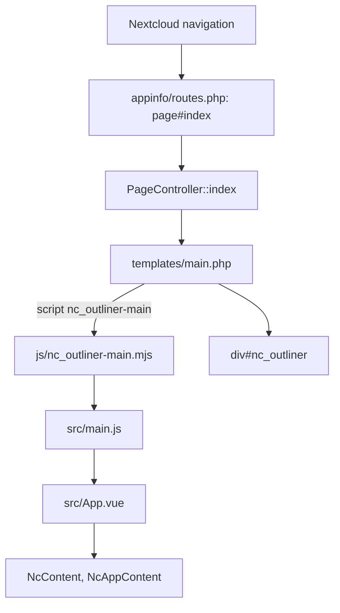

# nc-outliner code map

This map describes the Stage 2 skeleton (ticket S0, issue #84). It is written for the new layout: Vue 3 front end on Nextcloud's stack (ADR 0001), started fresh (ADR 0002). The old plain-JavaScript app is gone and nothing from it is mapped here. Check the branch you are on before assuming a module exists.

## Layout

| Path | What it is |
|---|---|
| `appinfo/info.xml` | App id `nc_outliner`, name "Outliner", Nextcloud 33 only, the navigation entry (route `nc_outliner.page.index`) |
| `appinfo/routes.php` | One route: `GET /` (page#index) |
| `lib/AppInfo/Application.php` | App bootstrap; holds `APP_ID` |
| `lib/Controller/PageController.php` | `index()` returns the `main` template |
| `templates/main.php` | Loads the built script `js/nc_outliner-main.mjs` and stylesheet `css/nc_outliner-style.css`; has the mount div `#nc_outliner` |
| `src/main.js` | Creates the Vue app and mounts it on `#nc_outliner` |
| `src/App.vue` | `NcContent` > `NcAppContent` > `h2` "Outlines" |
| `js/` | Build output of `npm run build` (generated, not edited) |
| `img/app.svg` | App icon |
| `vite.config.mjs` | `@nextcloud/vite-config`; entry `src/main.js`, output `js/` (script) and `css/` (one stylesheet) |
| `vitest.config.mjs` | jsdom environment for the JavaScript tests |
| `eslint.config.mjs` | `@nextcloud/eslint-config` (recommended) |
| `composer.json` | PHP autoload (`OCA\NcOutliner\` to `lib/`), phpunit and `nextcloud/ocp` for tests |

## Request and render flow

## Tests

| Check | Command | Where |
|---|---|---|
| Lint JS and Vue | `npm run lint` | `eslint.config.mjs` over the whole tree except `js/` |
| JavaScript | `npm test` | `tests/js/App.test.js` mounts `src/App.vue` and finds "Outlines" |
| Build | `npm run build` | `vite.config.mjs` writes `js/nc_outliner-main.mjs` and `css/nc_outliner-style.css` |
| PHP lint | `npm run lint:php` | `php -l` over `appinfo/`, `lib/`, `templates/`, `tests/` (`tests/tools/php.mjs`) |
| PHP tests | `npm run test:php` | `tests/php/PageControllerTest.php` with phpunit |

`tests/tools/php.mjs` uses a local PHP 8.4 or newer when one is on the PATH (or `PHP_BIN`). Otherwise it runs the existing `nextcloud:33.0.10-apache` image with networking off. It never pulls an image.

## Not covered yet

- No outline data, storage or API (later tickets).
- The page is checked by the built script containing "Outlines" and by the Nextcloud page returning 200. The rendered page in a real browser is not automated.
- See [docs/development.md](docs/development.md) for how to run each check.
