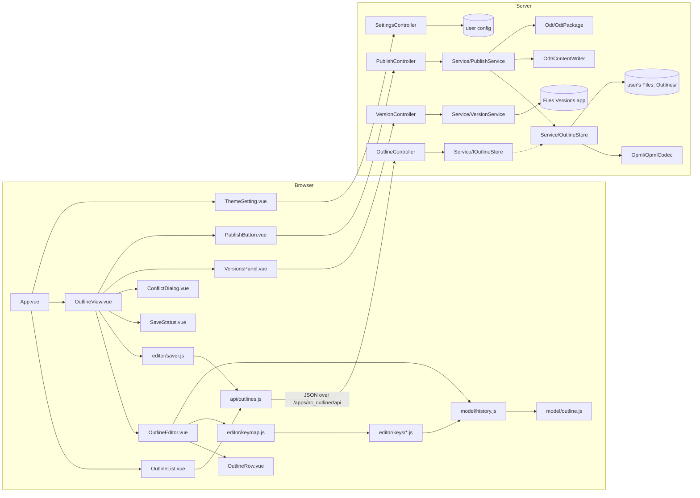

# nc-outliner code map

Every module 1.0 needs: where it lives, what it owns, what it exports, which issue fills it, and who calls whom. Vue 3 on Nextcloud's own stack (ADR 0001), started fresh (ADR 0002). The spec is [SPEC.md](SPEC.md); tickets and order are in [docs/plan/1.0-work.md](docs/plan/1.0-work.md).

Describes commit: 0b8d9e4 (2026-10-28)

**Status** on each module: **present** (on main and working), **stub** (on main with its signatures, body throws "not implemented"; the issue fills it in), or **planned** (not on main yet; the issue creates the file at the path given). Move a module's status in the PR that changes it.

## Contents

- [Skeleton (present)](#skeleton-present)
- [How the parts fit](#how-the-parts-fit)
- [Data shapes](#data-shapes)
- Server (PHP): [OPML codec](#opml-codec) · [ODT writer](#odt-writer) · [ODT package](#odt-package) · [Outline store](#outline-store) · [API](#api) · [Theme setting](#theme-setting) · [Versions](#versions) · [Import](#import) · [Publish](#publish)
- Browser (JS): [Outline model](#outline-model) · [History (undo and redo)](#history-undo-and-redo) · [Browser API client](#browser-api-client) · [Keyboard](#keyboard) · [Saver](#saver) · [Views and components](#views-and-components)
- [Mac, PC and Linux](#mac-pc-and-linux)
- [Open-source pieces](#open-source-pieces)
- [Tests](#tests)

## Skeleton (present)

Merged in #84.

| Path | What it is |
|---|---|
| `appinfo/info.xml` | App id `nc_outliner`, name "Outliner", Nextcloud 33 only, the navigation entry (route `nc_outliner.page.index`) |
| `appinfo/routes.php` | Routes: `GET /` (page#index), the five outline routes and the two settings routes (see [API](#api)). Later routes are added here |
| `lib/AppInfo/Application.php` | App bootstrap; holds `APP_ID`; registers `IOutlineStore` as an alias of `OutlineStore` |
| `lib/Controller/PageController.php` | `index()` returns the `main` template |
| `templates/main.php` | Loads the built script `js/nc_outliner-main.mjs` and stylesheet `css/nc_outliner-style.css`; has the mount div `#nc_outliner` |
| `src/main.js` | Creates the Vue app and mounts it on `#nc_outliner` |
| `src/App.vue` | `NcContent` > `NcAppContent` > `h2` "Outlines". Becomes the shell that shows the list or one outline |
| `js/`, `css/` | Build output of `npm run build` (generated, not edited) |
| `img/app.svg` | App icon |
| `vite.config.mjs` | `@nextcloud/vite-config`; entry `src/main.js`, output `js/` (script) and `css/` (one stylesheet) |
| `vitest.config.mjs` | jsdom environment for the JavaScript tests; `maxWorkers: 2` when `CI` is set, to bound worker startup on the shared runners |
| `eslint.config.mjs` | `@nextcloud/eslint-config` (recommended) |
| `composer.json` | PHP autoload (`OCA\NcOutliner\` to `lib/`), phpunit and `nextcloud/ocp` for tests |
| `tests/tools/php.mjs` | Runs `php -l` or phpunit with a local PHP 8.4+, else a throwaway `nextcloud:33.0.10-apache` container |
| `.github/workflows/check.yml` | CI: lint, JavaScript tests, build (Linux only), PHP lint and PHP tests; see [Mac, PC and Linux](#mac-pc-and-linux) |

## How the parts fit

The browser holds the outline as a tree and edits it; the server reads and writes the `.opml` file and turns OPML into JSON and back. The browser never sees OPML and never sends a path for an outline, only a file id.



## Data shapes

One row shape everywhere: in the browser model, in the JSON the API sends, and in PHP (`Row::toArray()` / `Row::fromArray()`).

```
Row     { id: string, text: string, note: string, collapsed: boolean, children: Row[] }
Tree    Row[]                                   (the root rows, in order)
Outline { title: string, rows: Tree, publishPath: string|null }
```

- `id` is stable and kept in the file (`nco:id`). New rows get one from `newId()` in the browser or `bin2hex(random_bytes(8))` on the server when a file has none.
- 1.0 rows have no rich text, styles or columns (SPEC Won'ts). The file keeps room for them: anything new goes in the `nco:` namespace, so no migration is forced later.
- #94 adds `noteHidden: boolean` (a note shown or hidden per row). #27 adds `state` for imported checkbox state (kept in the file, not shown in 1.0).

### OPML file layout

```xml
<?xml version="1.0" encoding="UTF-8"?>
<opml version="2.0" xmlns:nco="https://github.com/iannitram/nc-outliner/ns/1">
  <head>
    <title>Plan</title>
    <nco:publishPath>/Documents/Plan.odt</nco:publishPath>   <!-- only after a publish -->
  </head>
  <body>
    <outline text="A" _note="a note" nco:id="r1" nco:collapsed="true">
      <outline text="A1" nco:id="r2"/>
    </outline>
  </body>
</opml>
```

Notes use OPML's standard `_note` so OmniOutliner and other outliners read them; `nco:collapsed` is written only when true.

## Server (PHP)

All PHP lives under `lib/` in namespace `OCA\NcOutliner\`. Pure classes (codec, writer, package) touch no Nextcloud API and are tested with plain phpunit. Services and controllers use Nextcloud's public API (`OCP\`) only, and tests mock it (`nextcloud/ocp` in `composer.json`).

### OPML codec

| | |
|---|---|
| Files | `lib/Opml/Row.php` (present), `lib/Opml/Outline.php` (present), `lib/Opml/OpmlParseException.php` (present), `lib/Opml/OpmlCodec.php` (present) |
| Tests | `tests/php/Opml/OpmlCodecTest.php` (present) |
| Owns | OPML text to `Outline` and back. Pure |
| Issues | #85 `parse`, #103 `write` (both merged) |
| Called by | Outline store, Import |

```php
namespace OCA\NcOutliner\Opml;
final class Row { public string $id; public string $text; public string $note; public bool $collapsed; /** @var list<Row> */ public array $children;
    public function toArray(): array; public static function fromArray(array $data): Row; }
final class Outline { public string $title; /** @var list<Row> */ public array $rows; public ?string $publishPath; }
final class OpmlCodec {
    public const NS = 'https://github.com/iannitram/nc-outliner/ns/1';
    /** @throws OpmlParseException */ public function parse(string $xml): Outline;
    public function write(Outline $outline): string;
}
```

Parse with `DOMDocument::loadXML($xml, LIBXML_NONET)` and never `LIBXML_NOENT`: imported files are untrusted, so no external entities and no network. Invalid XML or no `<body>` throws `OpmlParseException`, never a partial tree.

### ODT writer

| | |
|---|---|
| File | `lib/Odt/ContentWriter.php` (present) |
| Tests | `tests/php/Odt/ContentWriterTest.php` (present) |
| Owns | Root rows to the `content.xml` of an `.odt`, by the heading rule (ADR 0003). Pure |
| Issue | #87 (merged) |
| Called by | Publish |

```php
namespace OCA\NcOutliner\Odt;
final class ContentWriter { /** @param list<Row> $rows */ public function contentXml(array $rows): string; }
```

Heading rule: top-level rows are `text:h text:outline-level="1"`; a second-level row with children is level 2; every deeper row, and a second-level row with no children, is a `text:list-item` in nested `text:list`s (list depth counts from the nearest heading); a note is a `text:p` right after its row's heading or inside its list item. Paragraph styles are named `Heading_20_1`, `Heading_20_2` and `Text_20_body`, which the package's `styles.xml` defines.

### ODT package

| | |
|---|---|
| File | `lib/Odt/OdtPackage.php` (present) |
| Tests | `tests/php/Odt/OdtPackageTest.php` (present) |
| Owns | Zips a `content.xml` with `mimetype`, `META-INF/manifest.xml` and a fixed light `styles.xml` into `.odt` bytes. Pure apart from a temp file |
| Issue | #112 (merged); #120 checks a generated `.odt` opens in LibreOffice and Nextcloud Office |
| Called by | Publish |

```php
namespace OCA\NcOutliner\Odt;
final class OdtPackage { public function build(string $contentXml): string; }
```

`mimetype` is the first entry, stored uncompressed, with content `application/vnd.oasis.opendocument.text`. Published docs always come out light (SPEC M12): `styles.xml` sets black text on white.

### Outline store

| | |
|---|---|
| Files | `lib/Service/OutlineStore.php`, `lib/Service/IOutlineStore.php` (the interface the controller depends on), `lib/Service/ConflictException.php`, `lib/Service/NotFoundException.php`, `lib/Service/FolderConflictException.php` (present) |
| Tests | `tests/php/Service/OutlineStoreTest.php`, `OutlineStoreFolderTest.php`, `OutlineStoreFolderEdgeTest.php` (present; mock `IRootFolder`) |
| Owns | The user's `Outlines/` folder and the `.opml` files in it, through Nextcloud's file API (`OCP\Files\IRootFolder::getUserFolder($uid)`), never direct disk writes. The etag check on save |
| Issues | #88 (merged); first-open folder races and the path conflict (#147, merged); #135 (make the etag check and write atomic) is open |
| Called by | API (through `IOutlineStore`), Publish, Versions, Import |

```php
namespace OCA\NcOutliner\Service;
final class OutlineStore implements IOutlineStore {
    public function __construct(IRootFolder $rootFolder, OpmlCodec $codec);
    /** @throws FolderConflictException when a file named Outlines already exists */
    public function ensureFolder(string $uid): Folder;                       // creates Outlines/ on first use; survives a concurrent first create
    /** @return list<array{fileId: int, name: string, mtime: int}> */
    public function list(string $uid): array;                                 // .opml files only, newest first
    /** @return array{fileId: int, name: string, etag: string} */
    public function create(string $uid, string $name): array;                 // empty outline; "Untitled" when name is ''
    /** @return array{fileId: int, name: string, etag: string, outline: Outline} */
    public function read(string $uid, int $fileId): array;
    /** @throws ConflictException when $ifMatch is not the file's current etag */
    public function save(string $uid, int $fileId, Outline $outline, string $ifMatch): string;   // returns the new etag
    /** @return array{fileId: int, name: string, etag: string} */
    public function saveCopy(string $uid, int $fileId, Outline $outline): array;  // "<name> (my copy).opml"
}
final class ConflictException extends \RuntimeException { public function __construct(public string $currentEtag); }
final class NotFoundException extends \RuntimeException {}
final class FolderConflictException extends \RuntimeException {}   // "Outlines" exists but is not a folder
```

`IOutlineStore` declares `list`, `create`, `read`, `save` and `saveCopy` (not `ensureFolder`); `Application::register()` aliases it to `OutlineStore`, and the controller tests mock the interface.

- A file id is looked up only inside that user's `Outlines/` folder, so another user's id is "not found", never readable.
- Names: an invalid name throws `\InvalidArgumentException` (the API answers 400); `.opml` added if missing; the characters `\ / : * ? " < > |` and trailing dots or spaces are refused, and a name that differs from an existing one only by case gets " (2)" ([Mac, PC and Linux](#mac-pc-and-linux)).
- Etag: the Nextcloud file etag (`Node::getEtag()`), compared just before `putContent`.

### API

| | |
|---|---|
| Files | `lib/Controller/OutlineController.php` (present), routes in `appinfo/routes.php` |
| Tests | `tests/php/Controller/OutlineControllerTest.php`, `OutlineControllerBodyTest.php`, `OutlineControllerNameTest.php`, `OutlineControllerParseTest.php` (present) |
| Owns | The JSON routes for outlines; the signed-in user from `IUserSession` |
| Issues | #108 (outline routes; merged), with the review fixes #134, #137, #138. Other routes come with their own issues, listed below |
| Called by | Browser API client |

All routes are under `/apps/nc_outliner/api`, take and return JSON, and are `#[NoAdminRequired]` (CSRF checked; the browser client sends the request token).

| Verb and path | Body | Answer | Issue |
|---|---|---|---|
| `GET /outlines` | | `200 [{fileId, name, mtime}]` · `409 {message}` when a file named `Outlines` is in the way | #108 |
| `POST /outlines` | `{name}` | `201 {fileId, name, etag}` · `400 {message}` for a bad name · `409 {message}` as above | #108 |
| `GET /outlines/{fileId}` | | `200 {fileId, name, etag, outline}` · `404` · `422 {message}` when the file is not a readable outline | #108 |
| `PUT /outlines/{fileId}` | `{outline}`, header `If-Match: <etag>` | `200 {etag}` · `412 {etag}` (changed elsewhere) · `404` · `400 {message}` without the header or without an `outline` with a `rows` array | #108 |
| `POST /outlines/{fileId}/copy` | `{outline}` | `201 {fileId, name, etag}` · `404` · `400 {message}` as for `PUT` | #108 |
| `POST /outlines/import` | multipart `file` | `201 {fileId, name, etag}` · `422 {message}` | #27 |
| `GET /settings` · `PUT /settings` | `{theme}` (`PUT` only) | `200 {theme}` · `400 {message}` for a value other than `auto`, `light` or `dark` | #109 (merged in #151) |
| `GET /outlines/{fileId}/versions` | | `200 [{versionId, mtime, size, label}]` | #4 |
| `GET /outlines/{fileId}/versions/{versionId}` | | `200 {outline}` (read-only) | #4 |
| `POST /outlines/{fileId}/versions/{versionId}/restore` | | `200 {etag}` | #4 |
| `PUT /outlines/{fileId}/versions/{versionId}/label` | `{label}` | `200 {label}` | #4 |
| `POST /outlines/{fileId}/publish` | `{folder, name}` | `200 {fileId, path, openUrl}` | #113 |

### Theme setting

| | |
|---|---|
| File | `lib/Controller/SettingsController.php` (present), routes `GET` and `PUT /api/settings` |
| Tests | `tests/php/Controller/SettingsControllerTest.php` (present) |
| Owns | The per-user theme override, `auto` (default), `light` or `dark`, in user config (`IConfig::getUserValue($uid, 'nc_outliner', 'theme', 'auto')`). A stored value outside the three reads back as `auto` |
| Issue | #109 (server; merged in #151), #96 (browser) |

### Versions

| | |
|---|---|
| Files | `lib/Service/VersionService.php`, `lib/Controller/VersionController.php` (planned) |
| Owns | An outline's versions: list with times, read one, restore one, label one so it is kept. Built on Nextcloud's own file versions (the Files Versions app), never a copy of our own |
| Issue | #4 (server), #111 (panel) |

Two ways in, to be settled in #4 and written down as an ADR: the Files Versions app's PHP API (`OCA\Files_Versions\Versions\IVersionManager`) behind our routes, or the browser talking WebDAV to `remote.php/dav/versions/<user>/versions/<fileId>` the way the Files app's own versions tab does (labels are a WebDAV property there). Restore must leave the current state findable as a version (SPEC M10); check what Nextcloud 33 does on restore before adding anything.

### Import

| | |
|---|---|
| File | `lib/Service/OutlineStore.php` gains `import(string $uid, string $fileName, string $xml): array` (planned); route in `OutlineController` |
| Owns | An uploaded OPML file becomes a new outline in `Outlines/`, after a full parse (so a broken file is refused whole) |
| Issue | #27 |

OmniOutliner's checkbox attribute must be read from a real OmniOutliner export (the issue needs one as a test file); it is kept as `state` on the row.

### Publish

| | |
|---|---|
| Files | `lib/Service/PublishService.php`, `lib/Controller/PublishController.php` (planned) |
| Owns | Outline to `.odt` in the folder the user picked, overwriting an earlier copy there (Nextcloud keeps its versions) |
| Issue | #113 (server), #9 (button, picker, open in Office) |

```php
final class PublishService {
    /** @return array{fileId: int, path: string} */
    public function publish(string $uid, int $outlineFileId, string $folder, string $name): array;
}
```

- `folder` is a path inside the user's own Files, from the picker. It is resolved through `getUserFolder($uid)->get($folder)`, must be a folder, and a path with `..` is refused.
- The server does not write the outline file. The browser stores the answer's `path` in `outline.publishPath`, and autosave keeps it, so the next publish offers it again and nothing races the editor's saves.

## Browser (JS)

All browser code lives under `src/` (ES modules, Vue 3 `<script setup>`, Nextcloud components). Pure modules (model, history, keymap groups, saver) are tested with vitest and need no DOM; components are tested with `@vue/test-utils` in jsdom.

### Outline model

| | |
|---|---|
| File | `src/model/outline.js` (present; every function below except `moveTo`, which is planned for #98) |
| Tests | `tests/js/model/outline.test.js` (present) |
| Owns | The tree and every change to it, as pure functions. Each returns a new tree, leaves its input unchanged, and moves a row's children with it. An operation that cannot apply (indent the first row, move the last row down) returns the input tree itself (`===`), which History reads as "no change" |
| Issues | #86 `insertAfter`, `remove`, `moveUp`, `moveDown` · #104 `indent`, `outdent` · #105 `updateRow` (all merged) · #98 adds `moveTo` |
| Called by | History, keyboard groups, drag |

```js
newRow(text = ''): Row                        // fresh id, empty note, not collapsed
newId(): string
insertAfter(tree, id, row): Tree              // row becomes the next sibling of id
remove(tree, id): Tree                        // with its children
moveUp(tree, id): Tree                        // swap with the previous sibling
moveDown(tree, id): Tree                      // swap with the next sibling
indent(tree, id): Tree                        // becomes the last child of its previous sibling
outdent(tree, id): Tree                       // becomes the next sibling of its parent
updateRow(tree, id, { text?, note?, collapsed? }): Tree
moveTo(tree, id, parentId | null, index): Tree   // #98, for drag
```

### History (undo and redo)

| | |
|---|---|
| File | `src/model/history.js` (present) |
| Tests | `tests/js/model/history.test.js` (present) |
| Owns | The current tree, the undo and redo stacks, and telling listeners after each change. Every edit in the app is `history.execute(op, args)` (SPEC M5) |
| Issue | #89 (merged) |
| Called by | Editor, keyboard groups, drag, OutlineView |

```js
createHistory(initial: Tree): {
  current(): Tree,
  execute(op, args, { mergeKey } = {}): boolean,   // false and no entry when op returns the same tree
  undo(): boolean, redo(): boolean, canUndo(): boolean, canRedo(): boolean,
  subscribe(listener: (tree) => void): () => void,
}
```

Trees are immutable, so an entry is the tree before the change. Typing uses `mergeKey: 'text:<rowId>'`, so a run of keystrokes in one row is one undo step.

### Browser API client

| | |
|---|---|
| File | `src/api/outlines.js` (present) |
| Tests | `tests/js/api/outlines.test.js` (present; mocks axios) |
| Owns | The HTTP calls to [the API](#api), with `@nextcloud/axios` (adds the request token) and `@nextcloud/router` `generateUrl('/apps/nc_outliner/api/...')` |
| Issue | #106 (outline calls; merged). #96 (settings calls), #4, #27 and #113's browser side add their own calls here |
| Called by | OutlineList, OutlineView, Saver |

```js
listOutlines(): Promise<OutlineEntry[]>
createOutline(name): Promise<{ fileId, name, etag }>
readOutline(fileId): Promise<{ fileId, name, etag, outline }>
saveOutline(fileId, outline, etag): Promise<{ ok: true, etag } | { conflict: true, etag }>   // 412 is an answer, not an error
saveCopy(fileId, outline): Promise<{ fileId, name, etag }>
```

### Keyboard

| | |
|---|---|
| Files | `src/editor/keymap.js` (present: the contract, `commandForKey`, `runCommand`, `modKey`, `isMac`), `src/editor/keys/editing.js`, `structure.js`, `move.js`, `fold.js` (stubs) |
| Tests | `tests/js/editor/keys/<group>.test.js` (planned, one per group) |
| Owns | Which key does what. Each group file owns its keys and its commands, so the key issues never edit the same file |
| Issues | #107 editing · #92 structure · #95 move · #93 fold |
| Called by | Editor (on keydown) |

```js
// each group in src/editor/keys/
binding(event: KeyInfo, context: KeyContext): string | null
commands: { [name]: (ctx: { history, rowId, focus(rowId, where?) }) => void }
```

| Key (Windows and Linux / Mac) | Command | Group | Issue |
|---|---|---|---|
| Enter | `newRowBelow` | editing | #107 |
| Backspace in an empty row | `deleteEmptyRow` | editing | #107 |
| Ctrl+Z / Cmd+Z | `undo` | editing | #107 |
| Ctrl+Shift+Z or Ctrl+Y / Cmd+Shift+Z | `redo` | editing | #107 |
| Tab | `indent` | structure | #92 |
| Shift+Tab | `outdent` | structure | #92 |
| Ctrl+Shift+Backspace / Cmd+Shift+Backspace | `deleteRow` | move | #95 |
| Alt+Up / Option+Up | `moveUp` | move | #95 |
| Alt+Down / Option+Down | `moveDown` | move | #95 |
| Left with the caret at the start of an expanded row with children | `collapse` | fold | #93 |
| Right with the caret at the end of a collapsed row | `expand` | fold | #93 |

Arrow keys alone (no modifier) keep their normal caret movement in every other case; Alt+Left is not used because it is the browser's Back on Windows and Linux.

### Saver

| | |
|---|---|
| File | `src/editor/saver.js` (planned) |
| Tests | `tests/js/editor/saver.test.js` (planned; vitest fake timers) |
| Owns | When to save, the save status, retrying, and spotting a conflict (SPEC M13). No Save button |
| Issue | #97 |
| Called by | OutlineView |

```js
createSaver({ save, delay = 1500, retryDelays = [2000, 5000, 15000], onStatus, onConflict }): {
  schedule(outline): void,      // (re)starts the pause timer
  flush(): Promise<void>,       // save now if anything is unsaved
  status(): 'saved' | 'saving' | 'error' | 'conflict',
}
```

OutlineView calls `flush()` on `visibilitychange` (hidden) and `pagehide`, and warns through `beforeunload` while anything is unsaved.

### Views and components

| File | Owns | Issue | Status |
|---|---|---|---|
| `src/App.vue` | Shell: the list, or one outline when the URL hash is `#/outline/<fileId>` (no router library); the theme class | #90, #96 | present (skeleton) |
| `src/views/OutlineList.vue` | My outlines, New outline, open one, Import | #90, #27 | planned |
| `src/views/OutlineView.vue` | Loads one outline, owns its History and Saver, hosts the editor, status, conflict dialog, versions and publish | #90, #97 | planned |
| `src/components/OutlineEditor.vue` | Renders the tree from History, caret and focus by row id, keydown to the keymap | #91 | present |
| `src/components/OutlineRow.vue` | One row: handle, disclosure triangle or bullet, a plain text input (no rich text in 1.0), the note under it | #91, #93, #94, #98 | present |
| `src/components/SaveStatus.vue` | Saved / Saving / Can't save (retrying) | #97 | planned |
| `src/components/ConflictDialog.vue` | Changed elsewhere: Reload, or Keep mine as a copy | #110 | planned |
| `src/components/VersionsPanel.vue` | Versions list, read-only preview, Restore, Name this version | #111 | planned |
| `src/components/PublishButton.vue` | Publish to Doc: folder picker, then open in Nextcloud Office | #9 | planned |
| `src/components/ThemeSetting.vue` | Auto / Light / Dark | #96 | planned |
| `src/main.js` + `src/App.vue` (Report a bug) | `installErrorBuffer()` at startup; craft-bugreport-web's `ReportButton` in the app navigation, given `{ app, version, commit, ncVersion, dropBase, dropToken, userName }` from initial state and `getWorkingFile()` returning the open outline as `.opml`; the drop base and token come from an admin setting stored server-side (`lib/Settings/`, IConfig app value) and are never committed | #124, #125 | planned |
| `appinfo/info.xml` + `.github/workflows/release.yml` (updates from the admin panel) | The release fields the merged feed reads (id, a.b.c version, Nextcloud 33 range, PHP minimum; guarded by `tests/js/release/infoxml.test.js`) and the tag workflow that calls craft-nc-appstore's `build-app.yml@v1`; signing and publishing happen on the release-key machine (R35), never in CI | #128, #129, #130 | planned |

Colours come only from Nextcloud's theme variables (`--color-main-background`, `--color-main-text`, `--color-border` and the rest), so the app follows Nextcloud's dark and light mode with no code. How the Light or Dark override forces the other set of variables inside the app is an open question for #96.

## Mac, PC and Linux

The app runs on a Nextcloud server and is used in a desktop browser, so "Mac, PC and Linux" means two things: the browser side works in desktop browsers on all three, and the code builds and its tests pass on all three. CI checks Linux and Windows on every push; the Mac check is not wired up yet (see CI below).

- **Browsers.** Current Firefox and Chromium browsers (Chrome, Edge) on all three, and Safari on the Mac. Use only standard DOM APIs; no browser-specific code.
- **Keys.** The primary modifier is Cmd on a Mac and Ctrl elsewhere (`modKey` in `src/editor/keymap.js`); Option on a Mac is Alt. Ctrl+Y as redo is Windows and Linux only. Every key test runs once with `isMac: true` and once with `false`.
- **Ids.** `newId()` falls back from `crypto.randomUUID` (HTTPS or localhost only) to `crypto.getRandomValues`, so a test Nextcloud on plain HTTP still works.
- **File names.** People sync `Outlines/` and published docs to Windows and Mac with the desktop client, whose file systems are case-insensitive and refuse some characters. The store and publish refuse `\ / : * ? " < > |` and trailing dots or spaces, and treat names that differ only by case as the same name.
- **Server paths.** PHP never builds a disk path: files go through Nextcloud's `Folder` and `File` API (always `/`). Temp files (the `.odt` zip) use `sys_get_temp_dir()` and `tempnam()`, removed in a `finally`.
- **Line endings.** `.gitattributes` keeps LF in every checkout; generated XML uses `"\n"`. Tests compare XML by parsing it, not by bytes, except where a test says byte-for-byte.
- **Locale and time.** Tests never depend on the machine's locale or time zone: names sort with `localeCompare(b, 'en')` where order matters, times are compared as integers (Unix seconds).
- **CI.** `.github/workflows/check.yml` runs lint, JavaScript tests, PHP lint and PHP tests on self-hosted Linux and Windows runners; the build runs once, on Linux. **There is no macOS job yet**: it waits for a Mac runner (GitHub-hosted runners are not used for this private repo), so Mac coverage today is the `isMac: true` key tests running on the other two. PHP comes from `setup-php` on Linux and from the runner's own install on Windows. Runs for one branch cancel each other (newest wins), and `vitest.config.mjs` caps test workers at 2 when `CI` is set. Issue #144 tracks the Windows worker start-up timeouts.

## Open-source pieces

What we bring in rather than write, and where it fits. New npm packages are added by the issue that first needs them.

| Piece | Where it fits | Status |
|---|---|---|
| `@nextcloud/vue` | Every component (NcContent, NcAppNavigation, NcListItem, NcButton, NcDialog, NcCheckboxRadioSwitch, NcActions) | in `package.json` |
| `@nextcloud/vite-config`, `@nextcloud/eslint-config` | Build and lint | in `package.json` |
| `@nextcloud/dialogs` | The Publish folder picker (`getFilePickerBuilder`) and toasts (`showError`, `showSuccess`) | in `package.json` |
| `@nextcloud/files` | File info and the WebDAV root, if versions go through WebDAV (#4) | in `package.json` |
| `@nextcloud/axios`, `@nextcloud/router` | The browser API client (#106): request token and app URLs | in `package.json` |
| PHP `DOMDocument` (ext-dom), `XMLWriter`, `ZipArchive` (ext-zip) | OPML parse, `content.xml`, the `.odt` zip. Nextcloud already requires these extensions | built in |
| Files Versions app | Versions and version labels (#4) | ships with Nextcloud |
| Nextcloud Office (richdocuments) | Opens the published `.odt` (#9): open the file through the Files app with `openfile=true`; check the exact URL on Nextcloud 33 | installed on the server |
| `sortablejs` (the drag library Nextcloud Tasks uses) | Candidate for drag (#98). Nesting by drop position is our own logic either way, through `moveTo`; native pointer events are the alternative | decide in #98 |
| TipTap (Nextcloud Text's editor) | After 1.0 only, for rich text (F15). Not in 1.0 | after-1.0 |

## Tests

| Check | Command | Where |
|---|---|---|
| Lint JS and Vue | `npm run lint` | `eslint.config.mjs` over the whole tree except `js/` |
| JavaScript | `npm test` | `tests/js/**/*.test.js` (vitest, jsdom) |
| Build | `npm run build` | `vite.config.mjs` writes `js/nc_outliner-main.mjs` and `css/nc_outliner-style.css` |
| PHP lint | `npm run lint:php` | `php -l` over `appinfo/`, `lib/`, `templates/`, `tests/` (`tests/tools/php.mjs`) |
| PHP tests | `npm run test:php` | `tests/php/**` with phpunit |

**Test-only stubs for server classes.** `nextcloud/ocp` ships the `OCP\` interfaces but not the `OC\` classes some of them extend (e.g. `OCP\Files\IRootFolder` extends `OC\Hooks\Emitter`), so mocking them fails. Minimal stubs for those live in `tests/stubs/OC/...`, autoloaded only in tests via `autoload-dev` `"OC\\": "tests/stubs/OC/"` in `composer.json`. Any issue whose tests mock such an interface may add a stub there; it is in scope for that issue. First added with #88.

`tests/tools/php.mjs` uses a local PHP 8.4 or newer when one is on the PATH (or `PHP_BIN`). Otherwise it runs the existing `nextcloud:33.0.10-apache` image with networking off. It never pulls an image. Each Must's check in SPEC.md is the test of record; automated tests run against a throwaway Nextcloud, never production. How to run each check: [docs/development.md](docs/development.md).
