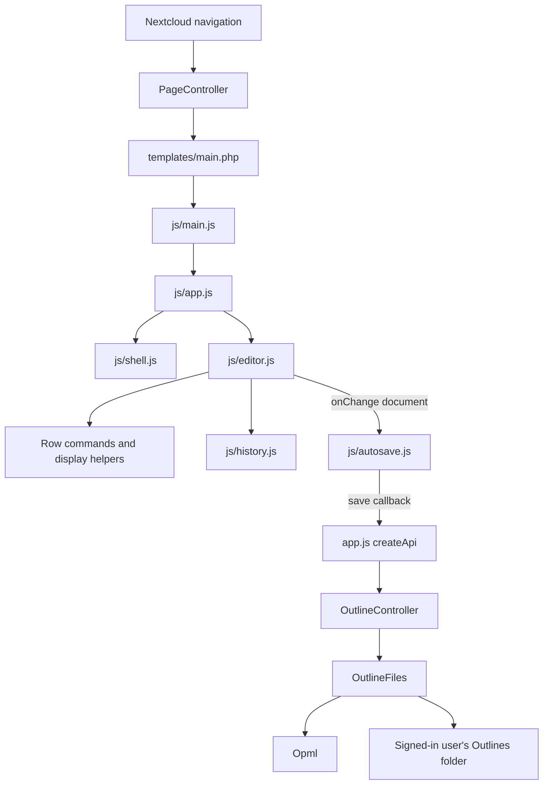

# nc-outliner code maps

These maps describe the implementation on `batch/3`, through PR #67. The feature stack is still under review; `main` currently contains the starter scaffold. Follow the source files on the branch you are changing rather than assuming every mapped module has merged.

| Map | Start here for |
|---|---|
| [Frontend](docs/code-maps/frontend.md) | Browser entry points, editor commands, history, autosave, import/export and appearance |
| [Backend and storage](docs/code-maps/backend.md) | Routes, controllers, user Files access, OPML fields, locking and ETags |
| [Tests and change guide](docs/code-maps/testing.md) | Which checks cover a change, test doubles, and verification limits |

## Request and edit flow

## Important boundaries

- The app is a Nextcloud 33 app with native JavaScript modules and PHP. There is no frontend build step or npm dependency tree; see [appinfo/info.xml](appinfo/info.xml) and [package.json](package.json).
- [app.js](js/app.js) owns the open file and its autosave lifecycle. [editor.js](js/editor.js) owns the in-memory document, DOM, selection and history.
- Document edits go through `context.change(mutator, meta)`. This is where history, focus restoration, extension hooks and the persistence callback meet. Search query and appearance are outside document history.
- The server obtains the user from `IUserSession`, then uses Nextcloud's Files API. Client `data-uid` is not authorization, and code never writes directly to the Nextcloud data directory.
- Unknown XML stays on the server and is carried forward from the original file by row ID. Adding a persistent field requires an explicit OPML codec mapping; preserving an arbitrary key in JavaScript alone does not save it.
- Draft PRs and closed issue records do not establish deployment or merge status. [ROADMAP.md](ROADMAP.md) links features to their PRs; [the review record](docs/batch-two-review.md) records the batch's verification scope and overlapping implementations.

## Where to start a change

| Change | Main touchpoints |
|---|---|
| New row command | Command module, `editor.js`, focused JS tests |
| New saved row/document property | Model/feature module, `Opml::read()` and `write()`, JS and PHP round-trip tests |
| File lifecycle or save conflict | `app.js`, `autosave.js`, `OutlineController`, `OutlineFiles` |
| New endpoint | `appinfo/routes.php`, controller, service, PHP tests, browser API caller |
| Visual layout | `shell.js`, `css/shell.css`, `css/outliner.css`; keep colors on `--ol-*` variables |
| Per-user preference | `theme.js` / `ThemePreferences` pattern; keep it separate from outline content |

Update the relevant map when moving an entry point, changing a contract, or adding a module. Coding and deployment instructions remain in [CLAUDE.md](CLAUDE.md).
